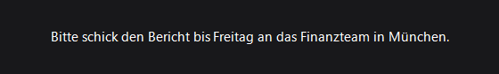
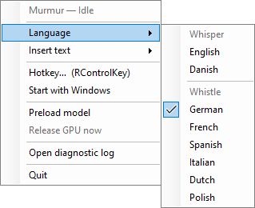
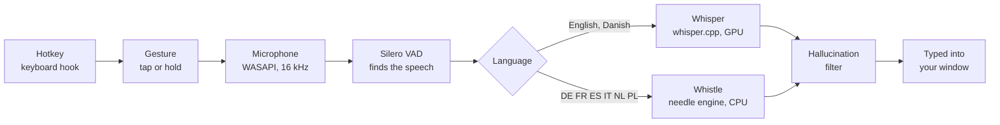

<div align="center">


# Murmur

**Hold a key, talk, and your words are typed into whatever app you're using.**<br>
Local speech-to-text for Windows. No account, no cloud, no audio leaves your PC.

[](https://github.com/ItzBloxy/Murmur/releases/latest)
[](LICENSE)


[**Download**](https://github.com/ItzBloxy/Murmur/releases/latest) ·
[How it works](#how-it-works) ·
[Languages](#languages) ·
[Build from source](#building-from-source)

<br>



</div>

## Why Murmur

- **Works in every app.** Murmur types where your cursor already is: email, chat, your editor, a game's chat box. There's no window to switch to.
- **Fully offline.** Speech recognition runs on your own GPU or CPU. The only network traffic is a one-time model download.
- **Fast.** On a mid-range graphics card, 12 seconds of speech comes back in about a quarter of a second.
- **Eight languages, two models.** English and Danish use OpenAI's Whisper. German, French, Spanish, Italian, Dutch and Polish use Whistle, a 17 MB model that runs on the CPU.
- **Careful by design.** It won't type into a window you switched to mid-dictation (the text goes to your clipboard instead), and it doesn't invent "Thanks for watching!" when you said nothing.
- **One file.** Download `Murmur.exe` and run it. Nothing to install or unzip, and no admin rights needed.

## Quick start

1. Download **`Murmur.exe`** from the [latest release](https://github.com/ItzBloxy/Murmur/releases/latest) and put it wherever you like.
2. Run it.
3. The first launch unpacks the app's runtime (a couple of seconds), then downloads the Whisper model (about 870 MB). Progress shows in the tray icon's tooltip, and this happens only once.
4. Click into any text field, **hold Right Ctrl**, speak, and let go.

> [!NOTE]
> Windows will probably show **"Windows protected your PC"**. The app isn't code-signed, and it uses a global keyboard hook to notice your hotkey from any application. That's the same Windows API a keylogger uses, so some antivirus tools flag it. Click **More info → Run anyway**. Murmur watches exactly one key, and the [source is right here](src/Murmur.Platform/LowLevelHotkeySource.cs).

## Using it

| Gesture | What happens |
|---|---|
| **Hold** Right Ctrl | Records while held. Let go and the text is inserted. |
| **Tap** Right Ctrl | Starts recording. Tap again to stop and insert. |

While Murmur listens, a small panel near the bottom of the screen shows what it has heard so far. Everything else is in the tray menu:



- **Language**: choosing a language also chooses its model (see [Languages](#languages)).
- **Insert text**: *When I stop* gives the best accuracy. *As I speak* types each phrase as you pause.
- **Hotkey…**: press any key to rebind it.
- **Start with Windows**
- **Preload model**: loads Whisper now, so your first dictation is instant.
- **Release GPU now**: frees graphics memory, for example before starting a game. The model also unloads itself after 5 idle minutes.
- **Open diagnostic log**

<br clear="right">

## Languages

| Model | Languages | Size | Runs on |
|---|---|---|---|
| [Whisper](https://github.com/openai/whisper) large-v3-turbo (q8_0) | English, Danish | ~870 MB | GPU via Vulkan or CUDA, CPU fallback |
| [Whistle](https://cactuscompute.com/blog/whistle) by Cactus Compute | German, French, Spanish, Italian, Dutch, Polish | ~18 MB | CPU only |

Picking a Whistle language releases Whisper's graphics memory straight away, and picking English or Danish switches back. Whistle downloads the first time you choose one of its languages. The engine and model are fetched from pinned revisions and checked against SHA-256 hashes before use.

## How it works



A few details that took some care:

- **Recording starts on key-down**, before Murmur knows whether you're tapping or holding, so the first word is never clipped.
- **Silence never reaches the model.** Whisper confidently invents subtitle credits for empty audio, so a voice-activity check gates every transcription, and a blocklist catches the known artifacts.
- **Text goes to the window you started in.** If focus moved while you were talking, Murmur copies the text to your clipboard rather than typing into the wrong window.
- **Whistle's audio never touches the disk.** Each transcription runs the needle engine as a short-lived process and streams the audio over a named pipe that only your user account can open.

### Performance

Measured on the development machine (RTX 3070, Ryzen 7 9800X3D):

| Backend | 12 s of speech |
|---|---|
| Whisper on CUDA 12 | 0.17 s |
| Whisper on Vulkan (the release build's GPU backend) | 0.25 s |
| Whisper on CPU only | ~10 s |
| Whistle on CPU, including process start and model load | ~0.12 s for a 5 s clip |

## Privacy

Everything runs locally. Murmur uses the network only for the one-time model downloads. Audio stays in memory for the duration of a dictation and is then discarded. There's no account, no telemetry and no analytics.

## Requirements

- Windows 10 or 11, 64-bit
- A microphone
- About 1 GB of free disk space for the models
- Any GPU from roughly 2012 onward with current drivers, for Whisper. Without one, Whisper falls back to the CPU and takes several seconds per dictation. Whistle languages always run on the CPU.

## Where it keeps things

| Path | Contents |
|---|---|
| `%LOCALAPPDATA%\Murmur\settings.json` | Your settings |
| `%LOCALAPPDATA%\Murmur\murmur.log` | Diagnostic log |
| `%LOCALAPPDATA%\Murmur\models\` | Downloaded models and the Whistle engine |
| `%TEMP%\.net\Murmur\` | The runtime `Murmur.exe` unpacks on first launch; safe to delete, it's recreated |

To remove Murmur completely, turn off *Start with Windows*, quit, and delete `Murmur.exe` and the folders above.

<details>
<summary><b>Settings reference</b></summary>

The tray menu covers the common settings. `settings.json` holds the rest; quit Murmur before editing it.

| Key | Default | Meaning |
|---|---|---|
| `language` | `"da"` | `en`, `da` (Whisper) or `de`, `fr`, `es`, `it`, `nl`, `pl` (Whistle) |
| `hotkey` | `"RControlKey"` | Any [`Keys`](https://learn.microsoft.com/dotnet/api/system.windows.forms.keys) name |
| `holdThresholdMs` | `700` | How long a press lasts before it counts as a hold rather than a tap |
| `insertMode` | `"onStop"` | `onStop` or `asYouSpeak` |
| `device` | `"auto"` | `auto` uses the best GPU backend available; `cpu` forces the CPU |
| `idleUnloadMinutes` | `5` | Unload Whisper after this long unused, unless preloaded |
| `maxRecordingMinutes` | `5` | Recording stops automatically after this |
| `vadSilenceMs` | `500` | Pause length that ends a phrase in *As I speak* mode |
| `startWithWindows` | `false` | Launch at sign-in |

</details>

<details>
<summary><b>Troubleshooting</b></summary>

Open the diagnostic log from the tray menu.

- **Slow transcription.** Find the line with `backend=`. `Vulkan` or `Cuda12` means the GPU is in use. `Cpu` means it couldn't be used, so update your graphics driver.
- **Nothing gets typed.** Look for a line saying focus changed. Murmur won't type into a different window from the one you started in, and puts the text on your clipboard instead.
- **Empty results.** Each recording logs its peak audio level. A peak near zero means Windows is using the wrong microphone, or it's muted.

</details>

## Building from source

You need the [.NET 10 SDK](https://dotnet.microsoft.com/download/dotnet/10.0) on Windows.

```powershell
git clone https://github.com/ItzBloxy/Murmur.git
cd Murmur
dotnet build
dotnet run --project src/Murmur.App
```

Run the tests:

```powershell
dotnet test --project tests/Murmur.Core.Tests          # fast, no hardware needed
dotnet test --project tests/Murmur.Integration.Tests   # real models, GPU, audio and UI
```

Integration tests tagged `Integration` download the real models, and tests tagged `UI` create real windows. Exclude them with `--filter-not-trait "Category=Integration" --filter-not-trait "Category=UI"`. The recorded-speech accuracy tests skip until you add your own clips; see [the fixtures README](tests/Murmur.Integration.Tests/fixtures/README.md).

Build the release exe:

```powershell
dotnet publish src/Murmur.App -c Release -r win-x64 --self-contained true -p:Portable=true -o dist/Murmur
```

That produces a single `dist/Murmur/Murmur.exe` of about 87 MB. `-p:Portable=true` bundles everything into one compressed file. It also leaves out the 752 MB CUDA runtime and relies on Vulkan, which every current GPU driver provides. On first launch the exe unpacks itself to `%TEMP%\.net\Murmur`. See [`native/README.md`](native/README.md) to enable CUDA for local builds.

### Project layout

| Project | What lives there |
|---|---|
| [`src/Murmur.Core`](src/Murmur.Core) | The dictation state machine, gesture recognition, language routing and the hallucination filter. Pure logic, fully unit-tested. |
| [`src/Murmur.Platform`](src/Murmur.Platform) | Windows and model integrations: the keyboard hook, WASAPI capture, text injection, Whisper, Whistle and Silero VAD. |
| [`src/Murmur.App`](src/Murmur.App) | The tray app: menu, overlay and composition root. |
| [`docs/superpowers`](docs/superpowers) | Design specs and implementation plans, including the reasoning behind each decision. |

## Acknowledgements

Murmur is a thin layer over excellent open work:
[whisper.cpp](https://github.com/ggml-org/whisper.cpp) and [Whisper.net](https://github.com/sandrohanea/whisper.net),
OpenAI's [Whisper](https://github.com/openai/whisper),
[Silero VAD](https://github.com/snakers4/silero-vad),
[Whistle and needle](https://github.com/cactus-compute/needle) by Cactus Compute,
and [NAudio](https://github.com/naudio/NAudio).

## License

[MIT](LICENSE). Third-party components and their licenses are listed in [THIRD-PARTY-NOTICES.txt](THIRD-PARTY-NOTICES.txt).
